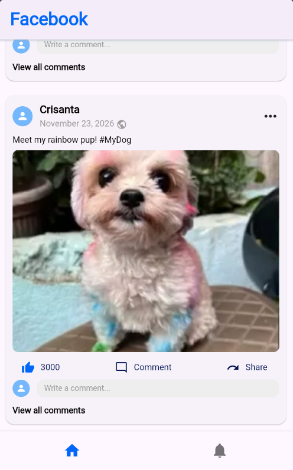
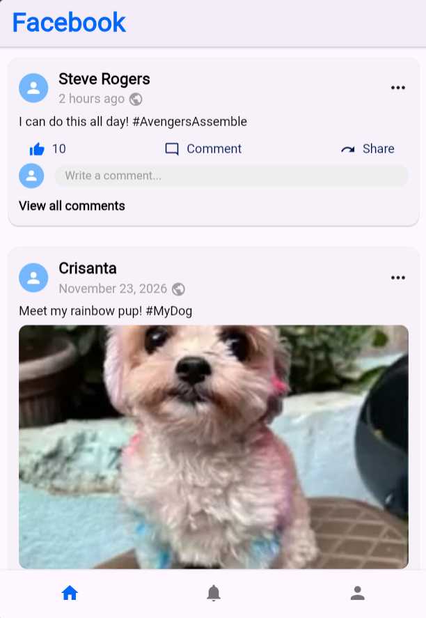
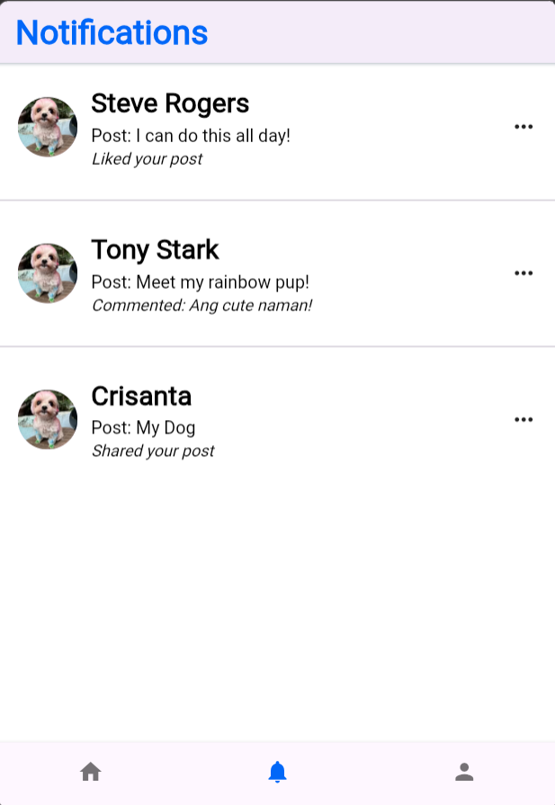
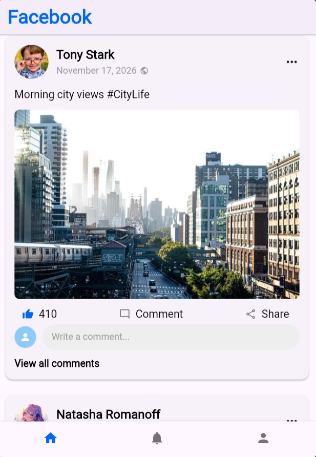
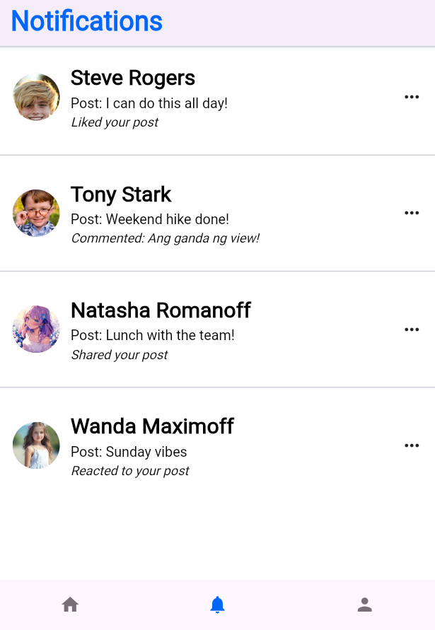

# dolosa_mobprog

Lab Activity 1A: File Structuring | Design Pattern
Lab Activity 2A: List Widgets

A Flutter replication of a social media app (newsfeed and notifications) built using `flutter_screenutil` and a widget-based file structure.

## Project Structure

```
lib/
├── screens/
│   ├── home_screen.dart
│   ├── newsfeed_screen.dart
│   └── notification_screen.dart
├── widgets/
│   ├── custom_text.dart
│   ├── newsfeed_card.dart
│   └── notification_widget.dart
├── constants.dart
└── main.dart
```

## Enhancements (Lab Activity 1)

1. **Image widget:** The post image area now uses the `Image.asset` widget instead of a hardcoded `AssetImage`.
2. **Avatar:** The plain person icon was replaced with a `CircleAvatar` for the user profile image (post header and comment box).
3. **Like, Comment and Share buttons:** All three are now widget-based using `TextButton.icon`.

## Screenshots (Lab Activity 1)

### Before Enhancement
The profile image is a plain person icon, the post image is a hardcoded `AssetImage` with square corners, and the Comment button is plain text (not a button widget).


### After Enhancement
The profile image is now a `CircleAvatar`, the post image uses a dynamic `Image.asset` with rounded corners, and Like, Comment and Share are all widget-based `TextButton.icon` buttons.




## Lab Activity 1: discussion

**Question:** Discuss how you integrate the Image to the newsfeed_card.dart and make it dynamic whether it has image or not.

**Answer:**

First, I added the image file inside `assets/images/` and registered the folder in `pubspec.yaml` under the `assets:` section so Flutter can load it.

Then, I added two optional (nullable) properties to the `NewsfeedCard` widget:

```dart
final bool? hasImage;
final String? imagePath;
```

Because both are optional, a post can be created with or without an image. In `newsfeed_card.dart`, I created a method that decides what to display:

```dart
Widget _buildPostImage() {
  if (hasImage == true && imagePath != null) {
    return ClipRRect(
      borderRadius: BorderRadius.circular(8),
      child: Image.asset(
        imagePath!,
        width: double.infinity,
        fit: BoxFit.cover,
      ),
    );
  }
  return const SizedBox.shrink();
}
```

If `hasImage` is `true` and an `imagePath` is provided, the card shows the picture using `Image.asset`. If not, it returns `SizedBox.shrink()`, which takes up no space, so the card simply has no image area.

Finally, in `newsfeed_screen.dart`, each post decides if it has an image by passing the values:

```dart
// Post without image
NewsfeedCard(
  userName: 'Steve Rogers',
  postContent: 'I can do this all day! #AvengersAssemble',
  date: '2 hours ago',
  numOfLikes: 10,
),

// Post with image
NewsfeedCard(
  userName: 'Crisanta',
  postContent: 'Meet my rainbow pup! #MyDog',
  date: 'November 23, 2026',
  numOfLikes: 3000,
  hasImage: true,
  imagePath: 'assets/images/mydog.jpg',
),
```

This makes the card reusable: the same `NewsfeedCard` widget can display any image by changing `imagePath`, or no image at all.

---

## Lab Activity 2: discussion

### Enhancements (Lab Activity 2)

1. **Dynamic post:** Every post has its own number of likes, a date, and either a picture, a grey placeholder box, or nothing.
2. **Dynamic AppBar title:** The title changes depending on the selected tab (Buzzly, Notifications, Profile).
3. **More BottomNavigationBarItem:** Added a third item (Profile) with its own page.
4. **App name:** Changed to **Buzzly**, stored in `constants.dart` as `appName`.
5. **Color palette:** Changed to a teal palette (UXITANCE 3) in `constants.dart`.

New files added: `notification_screen.dart` and `notification_widget.dart`.

### Screenshots (Lab Activity 2)

**Before Enhancement**

| Newsfeed | Notification |
|---|---|
|  |  |

**After Enhancement**

| Newsfeed | Notification |
|---|---|
|  |  |

### Laboratory Discussion

**Question:** Discuss how you manage to do the posts and the notification efficiently. Also, how you've accomplished the enhancement states the challenges and how you address them.

**How I managed the posts and notifications efficiently**

Instead of writing every post and notification as a separate widget, I stored the data in lists and let Flutter build the screens from them. The 10 posts are kept in a list of maps (name, date, text, likes, avatar, and an optional image). `ListView.builder` loops through that list and passes each item to one reusable `NewsfeedCard`. The 20 notifications work the same way: they are stored in one list (name, post, message, avatar) and displayed with `ListView.separated`, which makes the screen scrollable and adds a divider between items. One reusable `NotificationWidget` renders all of them, so adding or editing an item only means changing the data, not the layout code.

To make the posts dynamic, I added parameters to `NewsfeedCard`:

- `likes`: assigns the number of likes for each post
- `date`: assigns a date to every post
- `image` and `hasPlaceholder`: decide if a post shows a picture, a grey placeholder box, or nothing

```dart
Widget _buildMedia() {
  if (image != null) {
    return ClipRRect(
      borderRadius: BorderRadius.circular(8),
      child: Image.asset(image!, width: double.infinity, fit: BoxFit.cover),
    );
  }
  if (hasPlaceholder) {
    return Container(height: 180, color: Colors.grey.shade200);
  }
  return const SizedBox.shrink();
}
```

Note: in this lab I reorganized `NewsfeedCard`, so the parameter names changed from Lab 1 (`userName`, `postContent`, `numOfLikes`, `hasImage`, `imagePath` became `name`, `text`, `likes`, `image`, `hasPlaceholder`). The idea of showing or hiding the image is the same as in Lab 1.

**How I accomplished the enhancements**

1. *Dynamic post:* added the `likes`, `date`, `image`, and `hasPlaceholder` parameters described above.
2. *Dynamic AppBar title:* created a `_titles` list in `home_screen.dart` and used `_titles[_selectedIndex]` as the AppBar text, so it changes when the tab changes.
3. *More BottomNavigationBarItem:* added a Profile item and a matching page in the `PageView`, so the number of pages equals the number of nav items.
4. *App name:* saved the name in `constants.dart` (`appName`) and used it in `main.dart` and the AppBar, so it only needs to be changed in one place.
5. *Color palette:* replaced the color constants in `constants.dart` and set the theme in `main.dart` with `colorSchemeSeed: fbPrimary`.

**Challenges and how I addressed them**

1. *The bell icon showed a blank or old screen.* The `PageView` had only one page but the bottom bar had more items. I added `NotificationScreen()` and a Profile page so the pages match the nav items, and I used a full restart instead of a hot reload.
2. *Chrome crashed ("Aw, Snap!").* My original images were too large (some over 10 MB). I resized and compressed them to about 5 KB for avatars and under 60 KB for posts, and used `cacheWidth` in `Image.asset`. I also ran the app on a different device.
3. *Notifications looked repetitive.* My first version used auto-generated entries ("User 5", "User 6") that all looked the same. I replaced them with a complete list of 20 entries with real names, messages, and different avatars.
4. *Changes did not show up.* New assets and some list changes need a full restart (Shift + F5, then F5) instead of a hot reload.