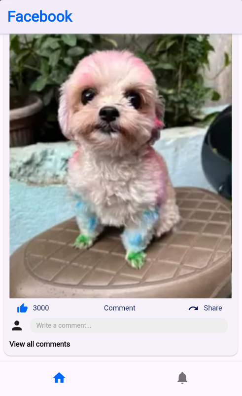

# dolosa_mobprog

Lab Activity 1A: File Structuring | Design Pattern

A Flutter replication of a Facebook newsfeed built using `flutter_screenutil` and a widget-based file structure.

## Project Structure

```
lib/
├── screens/
│   ├── home_screen.dart
│   └── newsfeed_screen.dart
├── widgets/
│   ├── custom_text.dart
│   └── newsfeed_card.dart
├── constants.dart
└── main.dart
```

## Enhancements

1. **Image widget:** The post image area now uses the `Image.asset` widget instead of a hardcoded `AssetImage`.
2. **Avatar:** The plain person icon was replaced with a `CircleAvatar` for the user profile image (post header and comment box).
3. **Like, Comment and Share buttons:** All three are now widget-based using `TextButton.icon`.

## Screenshots

### Before Enhancement
The profile image is a plain person icon, the post image is a hardcoded `AssetImage` with square corners, and the Comment button is plain text (not a button widget).




### After Enhancement
The profile image is now a `CircleAvatar`, the post image uses a dynamic `Image.asset` with rounded corners, and Like, Comment and Share are all widget-based `TextButton.icon` buttons.


## Lab Activity 1: discussion

**Question:** Discuss how you integrate the Image to the newsfeed_card.dart and make it dynamic whether it has image or not.

**Answer:**

First, I added the image file inside `assets/images/` and registered the folder in `pubspec.yaml` under the `assets:` section so Flutter can load it.

Then, I added two optional (nullable) properties to the `NewsfeedCard` widget:

```dart
final bool? hasImage;
final String? imagePath;
```

Because both are optional, a post can be created with or without an image. In `newsfeed_card.dart`, I created a method that decides what to display:

```dart
Widget _buildPostImage() {
  if (hasImage == true && imagePath != null) {
    return ClipRRect(
      borderRadius: BorderRadius.circular(8),
      child: Image.asset(
        imagePath!,
        width: double.infinity,
        fit: BoxFit.cover,
      ),
    );
  }
  return const SizedBox.shrink();
}
```

If `hasImage` is `true` and an `imagePath` is provided, the card shows the picture using `Image.asset`. If not, it returns `SizedBox.shrink()`, which takes up no space, so the card simply has no image area.

Finally, in `newsfeed_screen.dart`, each post decides if it has an image by passing the values:

```dart
// Post without image
NewsfeedCard(
  userName: 'Steve Rogers',
  postContent: 'I can do this all day! #AvengersAssemble',
  date: '2 hours ago',
  numOfLikes: 10,
),

// Post with image
NewsfeedCard(
  userName: 'Crisanta',
  postContent: 'Meet my rainbow pup! #MyDog',
  date: 'November 23, 2026',
  numOfLikes: 3000,
  hasImage: true,
  imagePath: 'assets/images/mydog.jpg',
),
```

This makes the card reusable: the same `NewsfeedCard` widget can display any image by changing `imagePath`, or no image at all.